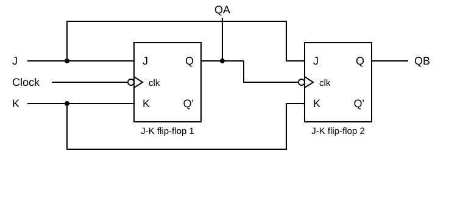
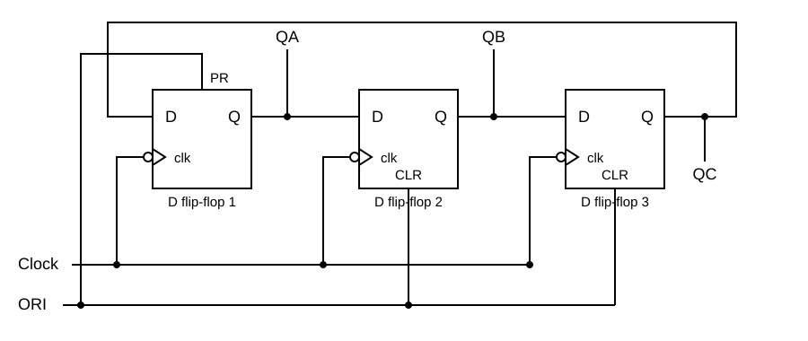
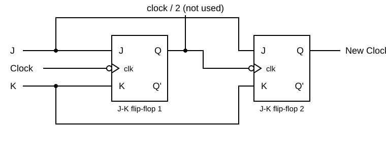

### Demo

The Demo has two pages, selected with the tabs at the top: **Basic Counter** (a 2-bit counter) and **Ring Counter** (a 3-bit ring counter).

1. The demo starts with the input values that the circuit needs: J = 1, K = 1 and Clock = 0 for the basic counter, Ori = 0 and Clock = 0 for the ring counter. You can click on the input bits to change them.
2. Click on **Start**. The input values travel through the circuit and the clock goes through its pulses. The output bits change at the falling edge of each clock pulse, and the observations panel tells what is happening. The same button pauses and resumes the run, and the speed can be changed (1x, 2x, 4x) while it runs.
3. When the run has finished, click on **Start** again to repeat it. **Reset** brings the circuit back to its starting values at any time.

The basic counter starts in the state QB QA = 11 and goes through 00, 01, 10, 11 with the four clock pulses. In the ring counter the set bit moves from QA to QB and then to QC.

### Practice

The Practice page has three tasks, one for each tab: **Basic Counter**, **Ring Counter** and **Frequency Divider**. In every task the input bits, the clock Clk and the output bits are already on the circuit board, and you build the counter between them from flip-flops.

#### General instructions

- Click on the flip-flop in the **Components** panel to add it to the board, drag it to move it, and connect components by dragging from one endpoint (the dots) to another. A wire can be dragged from an output point to an input point or the other way round. An output point can drive several inputs. An input point takes one wire only.
- To delete a wire or a component, right click on it and select **Delete**.
- Click on an input bit to toggle it between 1 and 0. The input bits start with the value 1, except Ori of the ring counter, which starts with 0. The clock Clk is a separate input: its value changes by itself while the simulation runs.
- The flip-flops are **negative-edge triggered**: they change their outputs when Clk goes from 1 to 0. Every J-K flip-flop starts with Q = 1.
- Click on **Simulate** to start the clock Clk (one clock pulse every 2 seconds). The output bits change at the falling edges of the clock. The button now reads **Stop**: click on it to stop the clock. **Reset** stops the clock too, and so does a change of tab. The **Submit** button works only when the clock is stopped.
- Click on **Submit** to check the circuit. A "Success" or "Fail" message and a table with the expected and the observed outputs are shown. The circuit must be completely connected, otherwise the component that is not connected properly is highlighted.

#### Task 1: 2-bit Asynchronous Binary Counter

_Figure 1: 2-bit asynchronous (ripple) binary counter. The clock drives the first flip-flop only, and the output Q of the first flip-flop (QA) is the clock of the second flip-flop. Reference: Theory section_

**Components required:** 2 J-K flip-flops. The input bits J and K, the clock Clk and the output bits QA (the least significant bit) and QB (the most significant bit) are on the board. The J-K flip-flop has the inputs J (upper), clk (middle) and K (lower) and the outputs Q (upper) and Q' (lower).

**Circuit connections:**

1. Drag the first J-K flip-flop and connect its J, K and clk input points to the **J**, **K** and **Clk** bits.
2. Drag the second J-K flip-flop and connect its J and K input points to the **J** and **K** bits (the bits J and K drive both flip-flops).
3. Connect the clk input of the second flip-flop to the Q output of the first flip-flop.
4. Connect the Q output of the first flip-flop to the **QA** output bit and the Q output of the second flip-flop to the **QB** output bit.
5. Keep J = K = 1, click on **Simulate** and watch QB QA count.

**Expected behaviour** (checked when you click on "Submit"; the counter starts in the state 11, so the first pulse gives 00):

| Clock pulses | QB | QA |
| ------------ | -- | -- |
| 0 (start)    | 1  | 1  |
| 1            | 0  | 0  |
| 2            | 0  | 1  |
| 3            | 1  | 0  |
| 4            | 1  | 1  |
| 5            | 0  | 0  |
| 6            | 0  | 1  |
| 7            | 1  | 0  |
| 8            | 1  | 1  |

#### Observations

- The output bits change in binary sequence 00 → 01 → 10 → 11 → 00 and so on, each time the clock goes from 1 to 0.
- QA is the least significant bit and QB the most significant bit of the count.
- QA changes at every clock pulse, QB changes when QA goes from 1 to 0 (the second flip-flop is clocked by QA, so the change ripples from the first to the second flip-flop).
- If the circuit has been made as described above, a "Success" message is displayed upon clicking "Submit".

#### Task 2: 3-bit Ring Counter

_Figure 2: 3-bit ring counter. The output of the last flip-flop is connected to the input of the first one. The input ORI presets the first flip-flop and clears the other two. Reference: Theory section_

**Components required:** 3 D flip-flops. The input bit Ori, the clock Clk and the output bits QA, QB and QC are on the board. The D flip-flop has the inputs D, PR (preset, on the top), clk and CLR (clear, on the bottom) and the outputs Q (upper) and Q' (lower). PR and CLR are active when the input is 0.

**Circuit connections:**

1. Drag 3 D flip-flops onto the board, one near the QA output bit, one near QB and one near QC.
2. Connect the **Ori** bit to PR of the first (uppermost) flip-flop and also to CLR of the other 2 flip-flops.
3. Connect the **Clk** bit to clk of all the 3 flip-flops.
4. Connect the D input of the first flip-flop to the Q output of the third (lowermost) flip-flop, the D input of the second flip-flop to the Q output of the first flip-flop and the D input of the third flip-flop to the Q output of the second flip-flop.
5. Connect the Q output of the first flip-flop to the **QA** bit, the Q output of the second flip-flop to **QB** and the Q output of the third flip-flop to **QC**.
6. Click on **Simulate**. The counter is initialised by Ori = 0 (QA = 1, QB = 0, QC = 0), then Ori becomes 1 and the clock starts.

**Expected behaviour** (checked when you click on "Submit", after the initialisation with Ori = 0):

| Clock pulses | QA | QB | QC |
| ------------ | -- | -- | -- |
| 0 (start)    | 1  | 0  | 0  |
| 1            | 0  | 1  | 0  |
| 2            | 0  | 0  | 1  |
| 3            | 1  | 0  | 0  |
| 4            | 0  | 1  | 0  |
| 5            | 0  | 0  | 1  |
| 6            | 1  | 0  | 0  |

#### Observations

- After the initialisation with Ori the output bits are QA = 1, QB = 0 and QC = 0.
- At each falling edge of the clock the set bit moves one place: QA, QB, QC → 100 → 010 → 001 → 100 and so on.
- Only one output is HIGH at any time (one-hot encoding), and the pattern repeats every 3 clock pulses.
- If the circuit has been made as described above, a "Success" message is displayed upon clicking "Submit".

#### Task 3: Frequency Divider

_Figure 3: Frequency divider made of two J-K flip-flops with J = K = 1. The first flip-flop divides the clock frequency by 2 and the second one by 4. Reference: Theory section_

**Components required:** 2 J-K flip-flops. The input bits J and K, the clock Clk and the output bit New Clock are on the board.

**Circuit connections:**

1. Drag the first J-K flip-flop and connect its J, K and clk input points to the **J**, **K** and **Clk** bits.
2. Drag the second J-K flip-flop and connect its J and K input points to the **J** and **K** bits, and its clk input to the Q output of the first flip-flop.
3. Connect the Q output of the second flip-flop to the **New Clock** output bit.
4. Keep J = K = 1 and click on **Simulate**. Watch how New Clock changes once for every two clock pulses.

**Expected behaviour** (checked when you click on "Submit", over 12 clock pulses): the output is low for 2 clock pulses, then high for 2 clock pulses, and so on, so that every value of the output is the opposite of the one 2 pulses before it. The phase of the signal does not matter.

#### Observations

- The first flip-flop divides the frequency of the clock by 2 and the second flip-flop divides it by 4, so New Clock has a quarter of the clock frequency.
- Each stage divides the frequency by 2, creating binary frequency relationships. A divider with n stages divides by 2ⁿ.
- The frequency divider shows a practical use of counters in clock generation circuits.
- If the circuit has been made as described above, a "Success" message is displayed upon clicking "Submit".

#### Troubleshooting

- **"Highlighted component not connected properly" or "... of Flip-Flop must be connected"**: every input and output of every flip-flop has to be connected, and every output bit has to be driven by the circuit.
- **Submit does not respond**: Submit is disabled while the clock runs. Click on "Stop" first.
- **The outputs of the counter do not change as expected**: check that the clk input of the second flip-flop is connected to the Q output of the first one, and not to the clock.
- **The ring counter shows 000 or 111**: check that Ori is connected to PR of the first flip-flop and to CLR of the other two.
